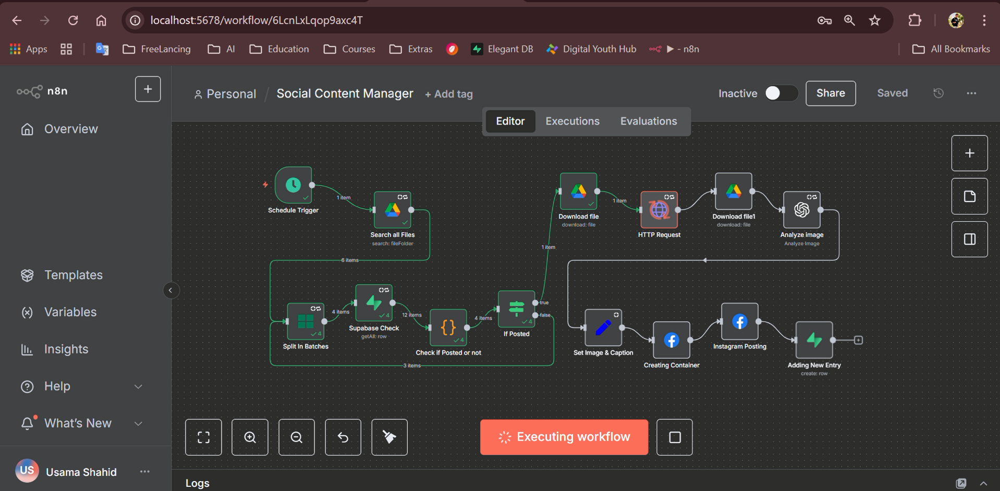
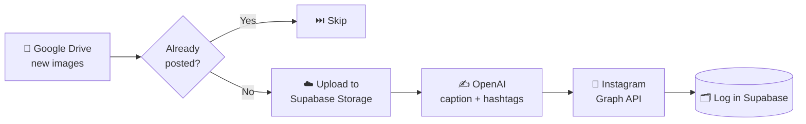
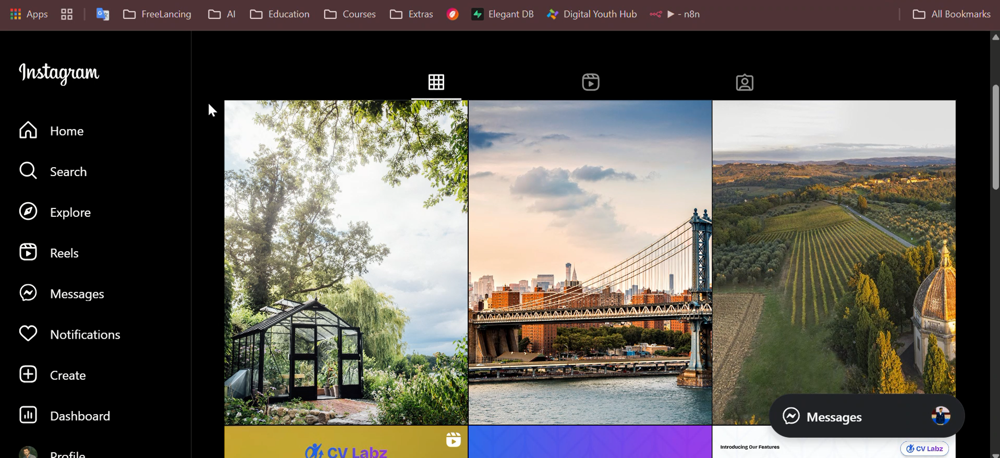

<!-- Social Content Engine · README by Usama Shahid (fewgets) -->
<div align="center">


<p>
  
  
  
  
  
</p>

</div>

---
## 📌 Overview

**Social Content Engine** is an **n8n** automation that runs your Instagram for you. Drop images
into a Google Drive folder and the workflow does the rest:

> 📂 finds new images → 🔁 skips anything already posted → ☁️ uploads to Supabase Storage →
> ✍️ writes a caption and hashtags with **OpenAI** → 📸 publishes to **Instagram** → 🗂️ logs the post.

---

## 🎥 Workflow

<p align="center">
  
</p>

---

## ✨ Features

| | Feature | Details |
|:-:|---|---|
| 📂 | **Google Drive source** | Watches a folder for new images |
| 🔁 | **No duplicates** | Every posted file is recorded in Supabase and skipped next time |
| ☁️ | **Public image hosting** | Uploads to a Supabase Storage bucket and generates a public URL |
| ✍️ | **AI captions** | `gpt-4o-mini` looks at the image and writes a caption with hashtags |
| 📸 | **Auto-publish** | Creates and publishes Instagram media through the Facebook Graph API |
| ⏱️ | **Scheduled** | Runs automatically, no manual steps |

---

## 🔄 How It Works



---

## 📷 Example Output

<p align="center">
  
</p>

---

## ⚙️ Setup

### ✅ Prerequisites
- A running **n8n** instance (self-hosted or cloud)
- **Google Drive API** with OAuth2 credentials
- A **Supabase** project
- A **Facebook App** linked to a Page and an Instagram **Business/Creator** account
- An **OpenAI** API key

### 1. Google Drive
Enable the Drive API, create OAuth2 credentials (redirect: `/rest/oauth2-credential/callback`) and
set your folder ID in the search node:
```text
'YOUR_FOLDER_ID' in parents and mimeType contains 'image/'
```

### 2. Supabase
Create a **public** storage bucket named `insta_uploads` and this table:
```sql
create table public.my_table (
  id         text primary key,
  name       text not null,
  created_at timestamptz default now()
);
```

### 3. OpenAI
Add your API key to the **OpenAI** node (model `gpt-4o-mini`).

### 4. Instagram / Facebook Graph API
Generate a Page access token with `instagram_content_publish`, then get your Instagram Business ID:
```text
GET /{page-id}?fields=instagram_business_account
```

### 5. Import and run
Import `Social Media Post.json` into n8n, connect the credentials, test node by node, then **activate**.

---

## 🧰 Tech Stack

| Component | Tool |
|---|---|
| Automation | [n8n](https://n8n.io) |
| Source | Google Drive |
| Database and Storage | Supabase (PostgreSQL + Storage) |
| AI Captions | OpenAI `gpt-4o-mini` |
| Publishing | Facebook Graph API (Instagram) |

---

## 🤝 Let's Work Together

<div align="center">

**Have an idea, a freelance project, or want to collaborate on something in AI?**
I'm always open to collaborations, freelance work and full-time opportunities.

<a href="mailto:shaikhusama541@gmail.com?subject=Collaboration%20-%20Social%20Content%20Engine">
  
</a>
<a href="https://www.linkedin.com/in/-usamashahid/">
  
</a>
<a href="https://github.com/fewgets">
  
</a>

<br/><br/>

⭐ **If you like this project, please give it a star. It really helps!** ⭐

<br/>

<h3>"Create once. Let automation do the posting."</h3>


</div>
